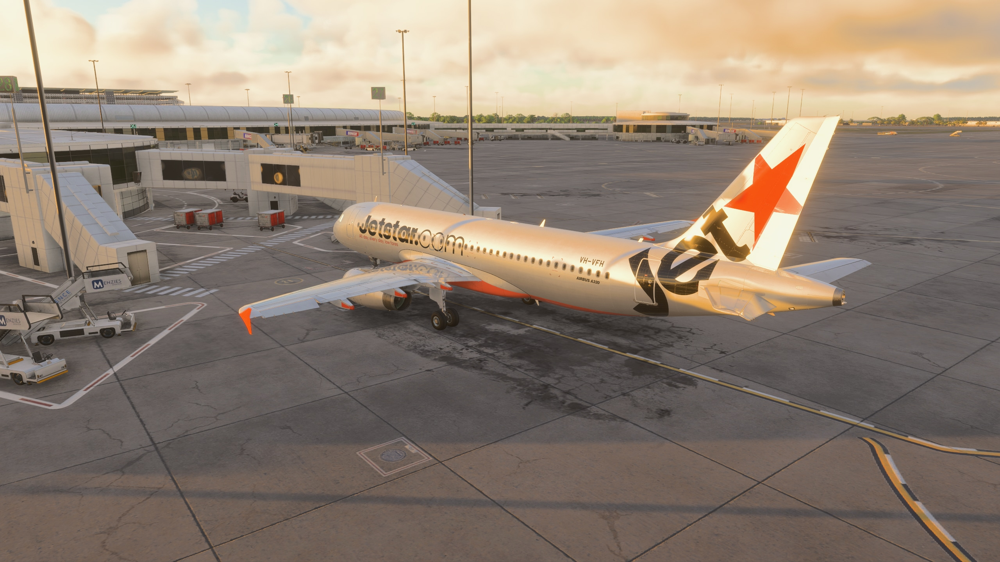
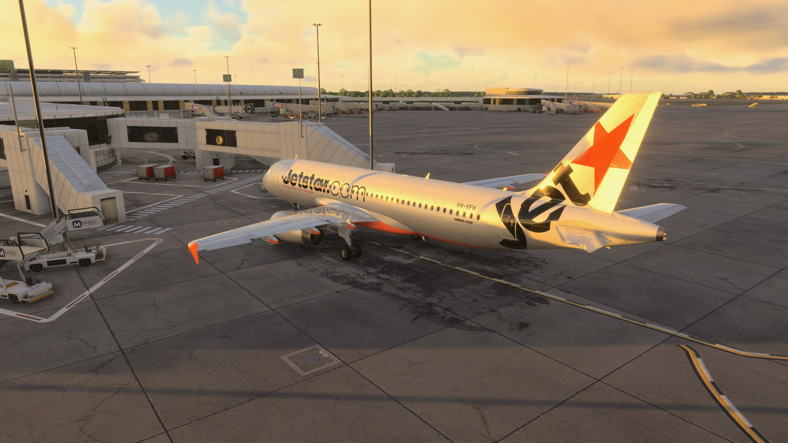

# Auto HDR-SDR Converter

I built Auto HDR-SDR Converter because HDR screenshots weren't being recognised by Volanta, and converting them by hand every time was a chore. It was made for Flight Simulator screenshots taken with NVIDIA, but it works with any `.jxr` image from any game.

Point it at a folder, and every new HDR screenshot (`.jxr`) is converted to an SDR `.jpg` for you. The conversion is done by HDRFix, which is bundled inside the app, so there is nothing extra to install. HDRFix was developed by Brooke Vibber: https://github.com/bvibber/hdrfix

<a href="https://www.buymeacoffee.com/thatsimpilot" target="_blank"></a>

## v1 vs v2

The same HDR screenshot converted by v1 (HDRFix defaults) and by v2 (tuned tone mapping):

| v1 | v2 |
|---|---|
|  |  |

v2 is tuned against the original HDR data so that colour, brightness and saturation stay as close to the HDR image as an SDR file allows (see [Tone presets](#tone-presets)).

See the [changelog](CHANGELOG.md) for everything that changed in v2.

## Install and use

1. Download `AutoHDRConvert.exe` from https://github.com/ThatSimPilot/Auto-HDR-SDR-Converter/releases. It is a single standalone file with nothing to install.
2. Move it to a folder of your choice (for example `C:\Tools\AutoHDRConvert` or your Documents folder) and run it from there. No other files are needed.
3. Optional: turn on **Start menu shortcut** in Settings to add it to the Start menu. The shortcut points at the exe's current location, so if you move the exe later, turn the switch off and on again.
4. Pick the **Watch folder** (where your screenshots are saved) and the **Save JPGs to** folder (it defaults to the same folder as the originals). Under **After converting**, choose whether to keep the original or move it to the Recycle Bin.
5. Press **Start**. New screenshots are converted as they arrive.

In **Settings** you can also choose:
* **Tone preset**: Match original or Brighter (see below).
* **When you close the window**: quit the app, or keep it running in the system tray.
* **Notifications**: Failures only, All conversions, or Off.
* **Start watching when the app opens**.
* **Write a log file**, handy for troubleshooting, and **where the log is saved**.
* **Settings folder**: where the settings file is kept (see [Where settings and logs live](#where-settings-and-logs-live)).
* **Start menu shortcut**: add or remove an entry in the Start menu.

### Tone presets
* **Match original**: reproduces the HDR image as closely as an SDR file can, assuming a typical SDR white level of 203 nits. Mid-tone brightness, colour and saturation are kept within a few percent of the HDR, and bright areas such as sunlit cloud keep their colour and detail instead of being bleached to white.
* **Brighter**: the same, as if your SDR white were 150 nits, so about 0.4 stop brighter.

An SDR file cannot show anything brighter than white, so very bright highlights (sun glints on a fuselage, for example) always come out dimmer than they look on an HDR display. HDRFix also never writes a pure 255 white, and the presets are a balance between keeping cloud detail and keeping bright surfaces bright. A native converter (see the roadmap) should do better.

### How it behaves
* Output files are named `<name>-sdr.jpg`. If that name is already taken, a number is added (`-sdr-1.jpg`) instead of overwriting.
* Only **new** `.jxr` files are converted. Files already in the folder when watching starts are left alone.
* Only the top level of the watch folder is watched, not its subfolders. `.jxr` is matched whatever the case, and files renamed or moved into the folder are picked up.
* The original is moved to the Recycle Bin only after the JPG has been verified, and only for files on fixed local drives. Otherwise the original is kept, and the activity list says so.
* Failures show in the recent activity list and, by default, as a notification.
* Only one copy of the app runs at a time. Opening it again brings the open window forward.
* If you chose to keep running in the tray, closing the window hides the app there. Single-click the tray icon to open the window again.

### Using a newer HDRFix (optional)
The app looks for `hdrfix.exe` next to `AutoHDRConvert.exe` first, then the copy bundled inside the app, then your PATH. To use a newer HDRFix, drop its `hdrfix.exe` next to `AutoHDRConvert.exe`.

## Where settings and logs live

The app follows the normal Windows locations and you can change both from **Settings**.
* **Settings file**: `%APPDATA%\AutoHDRConvert\config.json` by default. Choose another folder with **Change…** under **Settings folder** (your current settings are copied there), or **Use default** to go back. The choice is remembered in `%APPDATA%\AutoHDRConvert\config_location.txt`. If there is no settings file yet, a `config.json` beside the exe (from older versions) is read instead.
* **Log file** (only when **Write a log file** is on): `%LOCALAPPDATA%\AutoHDRConvert\logs\AutoHDRConvert.log` by default. Choose another folder with **Change…**, or **Use default** to go back. It rotates at about 1 MB and keeps one older copy. If the chosen folder can't be written to, the log goes to `%APPDATA%\AutoHDRConvert\AutoHDRConvert.log` instead.
* **Start menu shortcut**: `%APPDATA%\Microsoft\Windows\Start Menu\Programs\Auto HDR-SDR Converter.lnk`, created or removed by the Settings switch. It points at the exe's current location, so turn it off and on again if you move the exe.

Paste `%APPDATA%\AutoHDRConvert` into the Windows Explorer address bar to jump to the default settings folder. To remove the app completely, turn off the Start menu shortcut, delete the exe, then delete the settings and log folders.

## Troubleshooting

* **Nothing is converting**: check the Watch folder is the one your screenshot tool saves to, and that the status says Watching. Only new files are converted, so files already in the folder won't be picked up.
* **Some images fail**: turn on **Write a log file** in Settings, try again, and check the failed row in the activity list. The log has the details.
* **Windows SmartScreen warns about the app**: the exe is unsigned. Click **More info**, then **Run anyway**.

## Building from source

You will need Python on Windows. The build needs a `hdrfix.exe` in the repository folder.
```
python -m venv .venv
.venv\Scripts\activate
pip install -r requirements-dev.txt
build.cmd
```
That produces a single standalone file, `dist\AutoHDRConvert.exe`, built from `AutoHDRConvert.spec`. The spec bundles `hdrfix.exe`, `icon.png` and `icon.ico` from the repository folder. `build.cmd` runs `build.ps1`, so it works from cmd, PowerShell or a double-click. Close any running copy of the app first, because Windows won't let the build overwrite a running exe. Bump the version in `autohdr\__init__.py` for a release.

To run the tests:
```
python -m unittest discover -s tests
```

## Future Plans (Roadmap)

Further development will be limited by time and workload, but I will try to implement the following when I get a chance:
* **V3: a native converter** that doesn't need HDRFix, with proper control over how highlights roll off (true white, brighter bright surfaces and better cloud detail)
* **MSFS auto start**: launch the converter automatically when Microsoft Flight Simulator starts, and close it when the sim exits
* More tone settings beyond the two presets
* Start with Windows / start minimised

Any suggestions, requests or issues can be left by opening an issue or submitting a pull request, and I will try to take a look.

## Credits - HDRFix
### HDRFix
hdrfix is copyright 2021-2025 by Brooke Vibber

Permission is hereby granted, free of charge, to any person obtaining a copy of this software and associated documentation files (the “Software”), to deal in the Software without restriction, including without limitation the rights to use, copy, modify, merge, publish, distribute, sublicense, and/or sell copies of the Software, and to permit persons to whom the Software is furnished to do so, subject to the following conditions:

The above copyright notice and this permission notice shall be included in all copies or substantial portions of the Software.

THE SOFTWARE IS PROVIDED “AS IS”, WITHOUT WARRANTY OF ANY KIND, EXPRESS OR IMPLIED, INCLUDING BUT NOT LIMITED TO THE WARRANTIES OF MERCHANTABILITY, FITNESS FOR A PARTICULAR PURPOSE AND NONINFRINGEMENT. IN NO EVENT SHALL THE AUTHORS OR COPYRIGHT HOLDERS BE LIABLE FOR ANY CLAIM, DAMAGES OR OTHER LIABILITY, WHETHER IN AN ACTION OF CONTRACT, TORT OR OTHERWISE, ARISING FROM, OUT OF OR IN CONNECTION WITH THE SOFTWARE OR THE USE OR OTHER DEALINGS IN THE SOFTWARE.

### JPEGXR Library
HDRFix also uses BSD-licensed code from Microsoft and the license is found below or at https://github.com/bvibber/jpegxr

New BSD License (BSD)

Copyright (c) 2009, Microsoft All rights reserved.

Redistribution and use in source and binary forms, with or without modification, are permitted provided that the following conditions are met:

Redistributions of source code must retain the above copyright notice, this list of conditions and the following disclaimer.

Redistributions in binary form must reproduce the above copyright notice, this list of conditions and the following disclaimer in the documentation and/or other materials provided with the distribution.

THIS SOFTWARE IS PROVIDED BY THE COPYRIGHT HOLDERS AND CONTRIBUTORS "AS IS" AND ANY EXPRESS OR IMPLIED WARRANTIES, INCLUDING, BUT NOT LIMITED TO, THE IMPLIED WARRANTIES OF MERCHANTABILITY AND FITNESS FOR A PARTICULAR PURPOSE ARE DISCLAIMED. IN NO EVENT SHALL THE COPYRIGHT HOLDER OR CONTRIBUTORS BE LIABLE FOR ANY DIRECT, INDIRECT, INCIDENTAL, SPECIAL, EXEMPLARY, OR CONSEQUENTIAL DAMAGES (INCLUDING, BUT NOT LIMITED TO, PROCUREMENT OF SUBSTITUTE GOODS OR SERVICES; LOSS OF USE, DATA, OR PROFITS; OR BUSINESS INTERRUPTION) HOWEVER CAUSED AND ON ANY THEORY OF LIABILITY, WHETHER IN CONTRACT, STRICT LIABILITY, OR TORT (INCLUDING NEGLIGENCE OR OTHERWISE) ARISING IN ANY WAY OUT OF THE USE OF THIS SOFTWARE, EVEN IF ADVISED OF THE POSSIBILITY OF SUCH DAMAGE.

## License

MIT License

Copyright (c) 2025 Hayden Hookham

Permission is hereby granted, free of charge, to any person obtaining a copy
of this software and associated documentation files (the "Software"), to deal
in the Software without restriction, including without limitation the rights
to use, copy, modify, merge, publish, distribute, sublicense, and/or sell
copies of the Software, and to permit persons to whom the Software is
furnished to do so, subject to the following conditions:

The above copyright notice and this permission notice shall be included in all
copies or substantial portions of the Software.

THE SOFTWARE IS PROVIDED "AS IS", WITHOUT WARRANTY OF ANY KIND, EXPRESS OR
IMPLIED, INCLUDING BUT NOT LIMITED TO THE WARRANTIES OF MERCHANTABILITY,
FITNESS FOR A PARTICULAR PURPOSE AND NONINFRINGEMENT. IN NO EVENT SHALL THE
AUTHORS OR COPYRIGHT HOLDERS BE LIABLE FOR ANY CLAIM, DAMAGES OR OTHER
LIABILITY, WHETHER IN AN ACTION OF CONTRACT, TORT OR OTHERWISE, ARISING FROM,
OUT OF OR IN CONNECTION WITH THE SOFTWARE OR THE USE OR OTHER DEALINGS IN THE
SOFTWARE.
